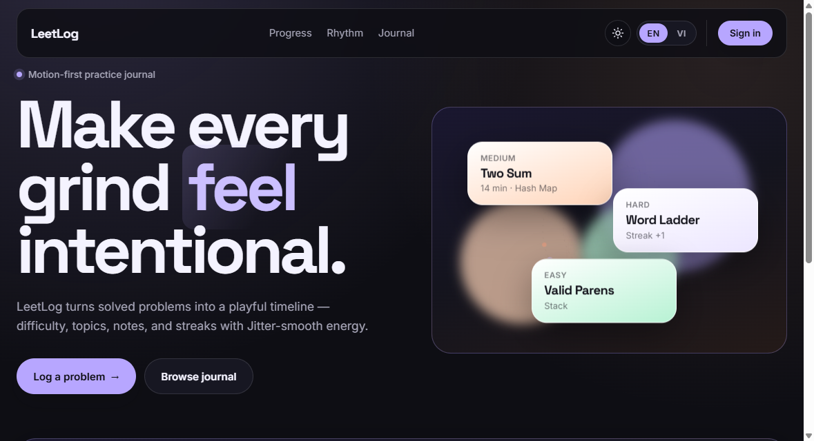
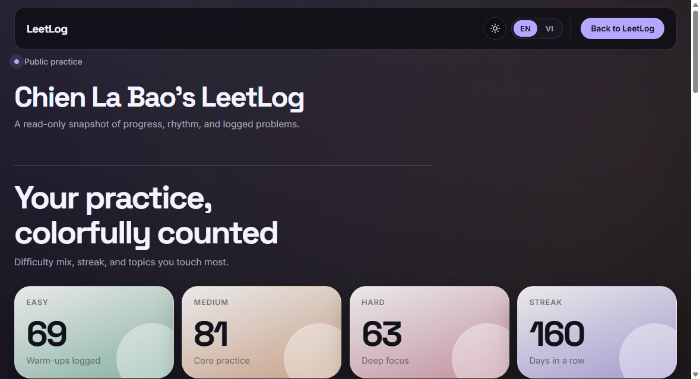
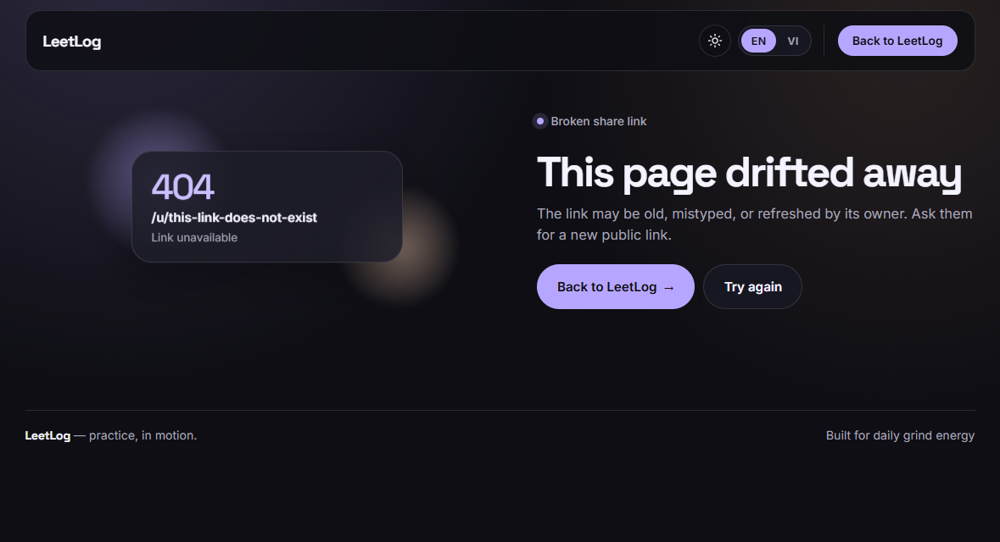

# LeetLog

Motion-first LeetCode practice journal — log solves, keep a streak, share a public profile when you want.



**Live:** [leet-log-five.vercel.app](https://leet-log-five.vercel.app) · **API:** [server-iota-eight-91.vercel.app](https://server-iota-eight-91.vercel.app)

## Stack

| Layer | Tech |
|-------|------|
| Client | Vite, React 19, TypeScript, CodeMirror |
| API | Express, TypeScript, JWT + bcrypt |
| DB | MongoDB + Mongoose (in-memory fallback for local demo) |

## Features

- **Progress / Rhythm / Journal** — dashboard stats, streak + heatmap, filterable entry list with pagination
- **Solutions** — store code per language (TypeScript, Go, Rust, C++, SQL) with syntax highlighting
- **Public share** — auto share slug at `/u/:slug`; regenerate anytime; custom 404 when the link is gone
- Light / dark theme and EN / VI i18n (persisted)
- Private by default; JWT auth per account





## Prerequisites

- Node.js 20+
- MongoDB optional: if `127.0.0.1:27017` is down, the API falls back to **in-memory MongoDB** (data resets when the server stops). Use local MongoDB or [Atlas](https://www.mongodb.com/atlas) for persistence.

## Setup

```bash
npm run install:all
```

```bash
copy server\.env.example server\.env
copy client\.env.example client\.env
```

`server/.env`:

```
MONGODB_URI=mongodb://127.0.0.1:27017/leetlog
PORT=4000
JWT_SECRET=change-me-to-a-long-random-string
```

`client/.env` (local API):

```
VITE_API_URL=http://localhost:4000
```

For production client builds, point `VITE_API_URL` at your deployed API.

### Seed demo data (optional)

```bash
npx tsx server/scripts/seed-user.ts <userId>
```

## Run

```bash
npm run dev
```

- UI: [http://localhost:5173](http://localhost:5173)
- API: [http://localhost:4000](http://localhost:4000) (Vite proxies `/api`)

## API

| Method | Path | Auth | Description |
|--------|------|------|-------------|
| POST | `/api/auth/register` | No | Create account |
| POST | `/api/auth/login` | No | Sign in |
| GET | `/api/auth/me` | Yes | Current user |
| POST | `/api/auth/share-link` | Yes | Ensure public share slug |
| POST | `/api/auth/share-link/regenerate` | Yes | Rotate share slug |
| PUT | `/api/auth/password` | Yes | Change password |
| GET | `/api/entries` | Yes | List (filters + pagination) |
| GET | `/api/entries/:id` | Yes | Get one |
| POST | `/api/entries` | Yes | Create |
| PUT | `/api/entries/:id` | Yes | Update |
| DELETE | `/api/entries/:id` | Yes | Delete |
| GET | `/api/stats` | Yes | Aggregates + streak + heatmap |
| GET | `/api/public/:slug` | No | Public profile + journal |

## Project layout

```
client/   React app (Vite)
server/   Express API + seed script
docs/screenshots/
```
